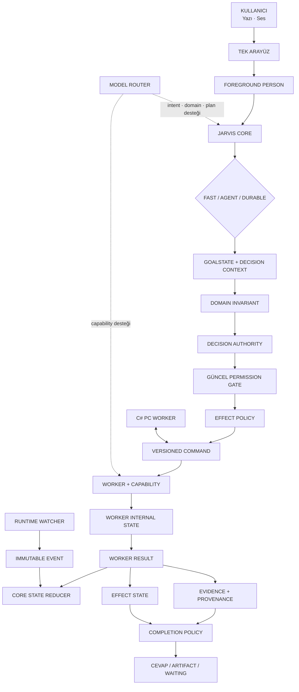

# Jarvis Execution Architecture v1 — Mimari Karar Taslağı

**Durum:** Ana mimari olarak kabul edildi — 23 Ekim 2026  
**Amaç:** Yeni özellik eklemekten önce Jarvis'in yürütme omurgasını sadeleştirmek, mevcut çalışan güvenlik mekanizmalarını korumak ve bütün alanları ortak sözleşmelere bağlamak.

**Durum dili:** **MEVCUT** bugünkü çalışan kodu, **HEDEF** kabul edilmiş fakat henüz uygulanmamış yapıyı, **GEÇİŞ** ise davranışı koruyarak hedefe taşımayı anlatır. Hedef bileşenler acceptance kanıtı olmadan hazır veya çalışıyor sayılmaz.

## 1. Ana karar

Jarvis'in hedef yapısı:

```text
TEK ARAYÜZ
    ↓
JARVIS CORE
    ↓
GOALSTATE + DECISION CONTEXT
    ↓
DOMAIN INVARIANT
    ↓
DECISION AUTHORITY
    ↓
GÜNCEL PERMISSION GATE
    ↓
EFFECT POLICY
    ↓
WORKER + CAPABILITY
    ↓
RESULT + EVIDENCE + EFFECT
    ↓
COMPLETION POLICY
    ↓
CEVAP / TESLİM
```

Yeni bir özellik için yeni görev, izin, retry, evidence veya watcher motoru kurulmaz. Mevcut çalışan mekanizmalar ortak sözleşmelere bağlanır.

Core her ayrıntıyı yapmaz:

```text
CORE   = Hangi capability, ne zaman, hangi kapsam ve yetkiyle çalışacak?
WORKER = Capability kendi alanında nasıl gerçekleştirilecek?
REDUCER = Global Job/GoalState hangi doğrulanmış olayla hangi sürüme geçecek?
```

**MEVCUT:** `goal_executor` ve `task_agents` ayrı üst düzey durum biçimleri kullanır; `tool_contract` mevcut `CONTRACT` sözlüklerini doğrular. Permission, evidence, outbox ve reconciliation parçaları çalışır; bütün capability'ler ortak zarfı kullanmaz.
**HEDEF:** Tek global Core State Reducer, ortak `GoalState`, `DecisionContext` ve `DecisionRecord` runtime nesneleriyle uygulanacaktır.
**GEÇİŞ:** Mevcut yürütücüler sökülmeden uyumluluk adaptörleriyle ortak sözleşmeye alınacaktır.

## 2. Tek arayüz ve kişi bağlamı

Jarvis'te tek bağlantı ve tek arayüz vardır. Aynı anda yalnız bir kişi ön plandadır:

```text
“Ben Hamdi” → foreground_person = hamdi
“Ben Hasan” → foreground_person = hasan
```

Bu seçim yeni hesap bağlantısı açmaz. Jarvis aynı arayüzde seçilen kişinin profilini, hafızasını ve çalışma bağlamını kullanır.

```text
foreground_person = Arayüzü şu anda kullanan kişi
job.owner         = İşi başlatan ve verinin ait olduğu değişmez kişi
```

Kurallar:

- Profil, hafıza, çalışma geçmişi, ders durumu, izin, hesap bağlantısı, dosya alanı ve yarım işler kişiye özeldir.
- “Ben Hamdi” demek işlem izni vermez; yalnız kişi bağlamını seçer.
- Güvenli salt okuma ve durable işler `job.owner` adına arka planda sürebilir.
- PC, mikrofon, sesli teslim veya kullanıcı onayı gereken adımda sahip ön planda değilse Job iptal edilmez:

```yaml
state: waiting
reason_code: FOREGROUND_OWNER_REQUIRED
```

- Bir kişinin sonucu, anahtarı veya bağlantısı diğer kişiye taşınmaz.

## 3. Jarvis Core'un sorumluluğu

Core şu kararların tek otoritesidir:

1. İsteğin sahibi kim?
2. Kullanıcı ne istiyor?
3. İş tek adımlı mı, çok adımlı mı, beklemeli mi?
4. Hangi domain ve capability kullanılacak?
5. Hangi izin sınıfı uygulanacak?
6. İş hangi durumda ve hangi adımdadır?
7. Sonuç yeniden denenebilir mi, uzlaştırma mı gerekir?
8. Kullanıcının hedefi gerçekten tamamlandı mı?
9. Hangi cevap veya artifact teslim edilecek?

Worker yalnız kendi çağrısının sonucunu döndürür. Global `done`, `waiting` veya `failed` kararını Completion Policy üzerinden Core verir.

## 4. Üç çalışma biçimi, tek yürütme sistemi

Fast Path, Agent Path ve Durable Job üç ayrı motor değildir; aynı Core'un çalışma biçimleridir.

| Yol | Kullanım | Planner |
|---|---|---|
| Fast Path | Tek, açık ve deterministik işlem | Kullanılmaz |
| Agent Path | Birden fazla capability gerektiren hedef | Başta strateji kurar |
| Durable Job | Ağ, kota, zaman, PC veya dış olay bekleyen iş | Checkpoint üzerinden sürer |

Örnekler:

```text
“Sesi 30 yap”                    → Fast Path
“İki raporu karşılaştır”        → Agent Path
“Son yedi günlük haberleri bul” → Agent Path
“CI bitince PC kabulünü çalıştır” → Durable Job
```

Planner her tur yeniden ne yapılacağını düşünmez. Plan kurulduktan sonra mümkün olan bölümler deterministik state machine ile yürür.

### 4.1. Fast Path hafif yürütme zarfı

Fast Path ayrı görev motoru değildir. Aynı Job, Step, Command, Permission, Result ve Completion sözleşmelerini daha hafif persistence politikasıyla kullanır:

```yaml
execution_mode: fast

job:
  persistence: lightweight
  step_count: 1
```

```text
Fast Path
= aynı Job/Step sözleşmesi
+ planner yok
+ minimum persistence
+ audit ve effect kaydı kalıcı
```

Salt okunur ve yan etkisiz hızlı işlerde tam durable plan ağacı diske yazılmak zorunda değildir. Yan etkili Fast Path işleminde `Command`, Permission Gate, dış çağrı öncesi effect intent/write-ahead kaydı, audit ve sonuç kanıtı hiçbir zaman atlanmaz. “Hızlı” güvenlik veya completion kontrolünü atlamak anlamına gelmez.

## 5. Kapsam korumalı domain yönlendirmesi

### 5.1. GoalState, karar sırası ve yazma otoritesi

`GoalState`, Core'un tuttuğu doğrulanmış kalıcı hedeftir; `DecisionContext` yalnız o karar turunun geçici bağlamıdır. Planlayıcının `proposed_next_action` önerisi GoalState'e kalıcı gerçek olarak yazılmaz.

```yaml
decision_context:
  goal_version: 8
  proposed_next_action: {}
  advisory_signals: []
  available_capabilities: []
  budget_snapshot: {}
```

Her capability çağrısının sabit sırası şöyledir:

```text
Domain invariant → Decision Authority → Permission → Effect Policy → Worker
```

`Decision Authority`, Manifest üst sınırı ∩ domain politikası ∩ kullanıcı bağlamı ∩ Job kapsamıdır; `Permission` bu yetkiden ayrıdır ve yan etkiden hemen önce güncel owner, hedef, grant ve politikayla yeniden değerlendirilir. Yalnız `pass + execute + allow + ready` Worker'a ulaşır; en kısıtlı karar kazanır.

**HEDEF:** Global Job ve GoalState'in tek mantıksal write authority'si Core State Reducer'dır. Model, Worker, Watcher, UI, Runtime Event ve Coding Backend yalnız Proposal/Result/Event üretir; Reducer `expected_version` denetimi, invariant, atomik compare-and-swap, `version + 1` ve audit uygular. Eski/tekrar sonuç state'i değiştiremez; domain kayıtlarının write authority'si kendi domaininde kalır.

WorkerResult fencing, `owner`, `job_id`, `step_id`, `command_id`, `attempt`, `expected_job_version`, capability sürümü ve `input_digest` eşleşmesini ister; eşleşmeyen sonuç `STALE_RESULT` olarak audit edilir ve state'i değiştirmez. Runtime Event freshness/dedup bundan ayrıdır: `event_id/source_event_key`, kaynak nesli, subject sürümü, zaman penceresi ve kayıtlı `wait_subscription/resume_token` denetlenir. Event yalnız Reducer girdisidir.

Crash recovery üç yoldan ilerler: intent yoksa yeni attempt yalnız politika uygunsa değerlendirilir; intent var ve receipt yoksa effect `unknown` olur, salt-okunur reconciliation yapılır ve kör retry yasaktır; doğrulanmış receipt varsa effect `succeeded` kabul edilir ve dış işlem tekrar edilmez. Yeni yan etki gerektiren reconciliation aynı karar sırasından yeniden geçer.

Replan bütçesi Core'a aittir: Fast Path varsayılan `0 replan`dır; yeni doğrulanmış evidence/effect/artifact/checkpoint/state sürümü olmadan ilerleme yoktur ve aynı normalize failure fingerprint sayılır. `DecisionRecord` yalnız karar, reason code, provenance, policy ve grant referanslarını saklar; gizli düşünce zinciri veya serbest model muhakemesi saklamaz.

Bütün capability kataloğu tek model promptuna verilmez:

```text
Kullanıcı isteği
→ Domain adayları
→ Core kapsam denetimi
→ Yalnız ilgili capability manifestleri
→ Gerekirse Planner seçimi
```

Ana domain'ler:

```text
pc
web
document
study
organizer
communication
developer
```

Planner veya worker yeni domain önerebilir; kendisi açamaz. Yeni domain ancak:

1. Kullanıcının asıl hedefiyle uyumluysa,
2. Güvenilmeyen içerikten türemediyse,
3. Decision Authority yürütmeye izin veriyorsa,
4. Permission Gate yeniden çalıştıysa,
5. Effect Policy güvenli yürütme koşulunu sağlıyorsa,
6. Gate `ask` döndürdüyse kullanıcı onayı alındıysa

kapsama eklenebilir.

## 6. Capability Manifest

Capability'nin sabit çalışma politikaları tek manifestte tutulur:

```yaml
capability:
  id: communication.mail.send
  version: 1
  worker: communication

  input_schema: mail_send.v1
  output_schema: worker_result.v1

  permission_class: message_out

  effect_policy:
    type: external_write
    idempotency: required
    write_ahead_journal: optional
    replay: conditional
    uncertain_result: reconcile
    reconciliation_capability: communication.mail.verify_sent
    compensation_capability: null

  execution:
    timeout_seconds: 30
    cancellation: cooperative
    cancel_ack_timeout_seconds: 2

  evidence_contract: mail_send_receipt.v1
```

Manifest yeni bir katalog değildir. Mevcut `tool_contract`, `task_tools`, `goal_tools`, `task_results`, izin sınıflandırması ve outcome sözleşmeleri uyumluluk adaptörleriyle tek kaynağa bağlanır. Statik metadata manifestte, çalıştırılabilir Python/C# binding dispatcher katmanında tutulur.

### 6.1. Capability yaşam döngüsü ve sürüm uzlaşması

Capability veya IPC sürümü kullanımdayken sessizce silinmez:

```text
Yeni sürümü paralel yayımla
→ Tüketicinin desteklediği sürümleri öğren
→ Ortak sürümü açıkça seç
→ Uyumluluk ve geçiş kanıtını topla
→ Eski sürümde çağrı kalmadığını doğrula
→ Eski sürümü kaldır
```

Manifest yaşam döngüsünü bildirir:

```yaml
lifecycle:
  status: active
  deprecated_since: null
  replacement: null
```

Python Core ile C# Worker bağlantı kurulurken destekledikleri IPC ve capability sürümlerini bildirir. Ortak sürüm yoksa tahminle devam edilmez; `CONTRACT_MISMATCH` döner. `deprecated` sürüm çalışmaya devam edebilir ancak yeni Job'larda tercih edilmez. Kaldırma yalnız kullanım kalmadığı ve göçün doğrulandığı kanıtlandıktan sonra yapılır.

### 6.2. Capability kaynak bütçesi

Timeout tek kaynak sınırı değildir. İhtiyaç duyan capability'ler manifestte ölçülebilir bütçeler tanımlar:

```yaml
resource_budget:
  max_input_bytes: 4194304
  max_output_bytes: 1048576
  max_model_calls: 3
  max_network_requests: 20
  max_artifacts: 5
  max_memory_mb: null
```

Belge, OCR, video ve araştırma capability'leri kendi gerçek sınırlarını tanımlar. Uygulanamayan bir sınır zorunluymuş gibi gösterilmez; `hard` ve `advisory` bütçeler uygulamada ayrılır. Bütçe model, belge veya web içeriği tarafından artırılamaz. Bütçe aşımı tamamlanmış yan etkileri silmez ve kanıtsız başarı üretmez.

## 7. Core Step ve Worker internal state

Core Step yalnız bağımsız capability çağrısını temsil eder:

```yaml
step:
  step_id: step-3
  capability_id: study.lesson.run
  capability_version: 1
  depends_on: [step-2]
  input_refs: [study-session-17]
  state: running
  attempt: 1
  checkpoint: null
  required_evidence: []
```

Worker'ın iç algoritması Core Step'e çevrilmez. Hoca'nın ders adımları, OCR sayfaları, parser aşamaları veya Developer'ın model-tool döngüsü worker internal state olarak kalabilir.

Mevcut `goal_executor` ve `task_agents` bir anda sökülmez. Ortak Step adaptörü arkasına alınır; davranış eşitliği kanıtlandıktan sonra çift üst düzey sözleşme kaldırılır.

## 8. Command, Result ve Event

### Command

```yaml
command:
  contract_version: 1
  command_id: cmd-17
  job_id: job-184
  step_id: step-3
  owner: hamdi
  capability_id: communication.mail.send
  capability_version: 1
  attempt: 1
  deadline_at: ""
  idempotency_key: "job-184:step-3"
  input_digest: "sha256:..."
  input: {}
```

### WorkerResult

```yaml
result:
  contract_version: 1
  command_id: cmd-17
  job_id: job-184
  step_id: step-3
  outcome: success
  data: {}
  evidence: []
  artifacts: []
  effects: []
  checkpoint: null
  error: null
```

Worker outcome değerleri:

```text
success
partial
blocked
retryable_failure
permanent_failure
cancelled
```

### Event

```yaml
event:
  contract_version: 1
  event_id: "pc_test_finished:jarvis-v2:a853e86:v3"
  source_event_key: "jarvis-v2:a853e86:windows_acceptance"
  event_type: pc_test_finished
  occurred_at: ""
  payload: {}
  payload_hash: "sha256:..."
```

Event kimliği kaynak sistemden gelir veya kaynak + nesne sürümü + olay türünden deterministik üretilir. `payload_hash` bütünlük kanıtıdır; tek başına duplicate kimliği değildir.

## 9. Job durumları ve bekleme nedenleri

Ana durum kümesi küçük tutulur:

```text
queued
running
waiting
done
failed
cancelled
```

Ayrıntı `reason_code` ile taşınır:

```text
FOREGROUND_OWNER_REQUIRED
PERMISSION_REQUIRED
EXTERNAL_EVENT_REQUIRED
MODEL_QUOTA
NETWORK_UNAVAILABLE
RECONCILIATION_REQUIRED
INSUFFICIENT_EVIDENCE
```

`partial`, `blocked` ve `retryable_failure` worker sonucudur; yeni global Job state olmak zorunda değildir.

## 10. Permission Gate ve Grant

Permission Gate tek izin otoritesidir. Mevcut sınıflar korunur:

```text
read
local_reversible
local_destructive
external_write
message_out
publish
money_credential
system_config
physical
```

Grant gerektiğinde şu kapsamı taşır:

```yaml
grant:
  owner: hamdi
  capability_id: communication.message.send
  permission_class: message_out
  target_id: ahmet
  scope: once
  job_id: job-184
  step_id: step-7
  command_digest: "sha256:..."
  max_uses: 1
  expires_at: ""
```

Kurallar:

- Grant'i model, web, mail gövdesi veya belge içeriği değiştiremez.
- `message_out` kesin hedefe bağlı kalır.
- `publish` genel session izniyle açılmaz.
- `external_write` özel dış hesaptaki kaydı oluşturma, değiştirme veya silmedir; varsayılanı `ask`tır. Açık owner, kesin provider/account/resource, idempotency ve reconciliation zorunludur; başlangıçta standing grant yoktur.
- Dış kaydı silme riski yeni permission sınıfıyla değil `external_write` üzerindeki destructive Effect Policy ile gösterilir.
- `physical` gerçek cihaz etkilerini kapsar.
- `money_credential` ve `system_config` kilitleri korunur.
- Permission Policy `deny` kararı her yolda kesin rettir.

## 11. Hedef sabitleme ve güvenilmeyen içerik

Mesaj, mail veya yayın hedefi yalnız şunlardan gelir:

1. Kullanıcının açık isteği,
2. Kayıtlı kişi veya doğrulanmış hesap metadata'sı,
3. Kullanıcının açıkça “cevapla” dediği doğrulanmış mesaj göndericisi.

Mail gövdesi, PDF, web sayfası, dosya talimatı, model çıktısı veya prompt injection hedefi değiştiremez.

## 12. Effect, idempotency ve reconciliation

Result outcome ile gerçek dünya etkisi ayrıdır:

```yaml
effect:
  effect_id: effect-4
  type: communication.mail.send
  state: unknown
  next_action: reconcile
  target_ref: contact-ahmet
  requested_digest: "sha256:..."
  receipt_ref: null
```

Effect state:

```text
not_started
succeeded
failed
unknown
```

Sonraki işlem:

```text
none
reconcile
ask_user
compensate
```

`unknown` etki otomatik tekrar edilmez.

```text
Outbox work_key       = deduplication / idempotency
Desktop pending_effect = write-ahead intent journal
```

Telafi otomatik rollback değildir. Yeni capability çağrısıdır; yeniden izin ve kanıt denetiminden geçer.

## 13. Evidence, güven ve provenance

```yaml
evidence:
  evidence_id: ev-17
  owner: hamdi

  origin:
    type: document
    source_id: pdf-7
    location:
      page: 14

  trust:
    data_class: user_supplied
    instruction_authority: none
    assigned_by: core_policy

  captured_at: ""
  content_hash: "sha256:..."
  capture_method: document_parser.v2
```

Kurallar:

- Trust sınıfını model veya kaynak belirlemez; Core policy belirler.
- Veri güvenilirliği işlem yetkisi anlamına gelmez.
- Kullanıcıya sunulan veya Jarvis kararını etkileyen her türetilmiş bilgi `derived_from` zinciri taşır.
- Evidence, receipt, audit ve tamamlanmış effect kayıtları değiştirilmez; yeni kayıt üretilir.

Ham evidence kendi `origin`, `location`, `content_hash` ve `capture_method` alanlarıyla kaynak nesnesidir; `derived_from: []` taşıması zorunlu değildir. Türetilmiş bütün nesnelerde tek bağlantı alanı kullanılır:

```yaml
fact:
  id: fact-5
  value: "Sınav 3 Kasım"
  derived_from: [ev-17]

interpretation:
  id: int-8
  value: "Hazırlık süresi kısa"
  derived_from: [fact-5]

recommendation:
  id: rec-2
  value: "Bugün integral çalış."
  derived_from: [fact-5, study-progress-8]
```

`evidence_refs` adında ikinci bir türetme alanı kullanılmaz; provenance bağlantısının standart adı `derived_from` olur.

```text
Öneri
→ Yorum
→ Fact
→ Evidence
→ Gerçek kaynak / sayfa / URL
```

## 14. Completion Policy

Worker kendi capability'si için `success` dönebilir; bu global hedefin tamamlandığı anlamına gelmez.

Örnek haber tamamlanma kuralı:

```text
DISCOVER
→ READ
→ VERIFY DATE
→ VERIFY SOURCE
→ En az iki farklı yayıncıdan iki geçerli URL'ye bağlı makbuz var mı?
    EVET → teslim
    HAYIR → başka kayıtlı kaynak
             ↓
          bütçe bitti
             ↓
          waiting / insufficient evidence
```

Model tarih, URL, izin veya tamamlanma kararı vermez. Bunlar kodla doğrulanır.

## 15. Worker/domain sınırları

Üst düzey bir domain worker başka domain worker'a emir veremez veya onun durumunu değiştiremez:

```text
Study → Core → Communication
Document → Core → Web
```

Domain'in kendi yardımcıları serbesttir:

```text
Document → PDF parser / OCR adapter
Communication → Gmail adapter
PC → Windows UI Automation
Web → HTTP client
```

Kod seviyesinde kullanıcıya “ajan” denebilir; mimari ve kod seviyesinde yürütücüler **Worker/Capability** olarak adlandırılır.

## 16. PC sistemi — C# Worker

Python Core karar, izin, Job ve completion sahibidir. C# Worker Windows gözlem ve işlemlerini yürütür.

IPC Command en az şu alanları taşır:

```yaml
ipc_version: 1
command_id: cmd-44
job_id: job-184
step_id: step-3
owner: hamdi
capability_id: pc.window.control
capability_version: 1
deadline_at: ""
idempotency_key: ""
expected_observation_version: ""
input_mode: uia_pattern   # uia_pattern | physical_input
target:
  app: ""
  hwnd: 0
  pid: 0
input: {}
```

C# Worker kendi başına kullanıcı hedefi veya global Job oluşturamaz.

`target`, Core'un onayladığı pencere kimliğidir; Worker işlemden hemen önce aynı `app/hwnd/pid` üçlüsünü yeniden gözler, uyuşmazsa komutu göndermeden `NotSent` döner. PC Worker hedefleri Core politikasında üç sınıfta tutulur, Worker'a güvenilmez:

| Sınıf | Uygulamalar | Kural |
|---|---|---|
| Yasak | Jarvis'in kendi penceresi; uzak erişim (`mstsc`, `anydesk`, `teamviewer`, `putty`, `winscp`) | Hiç hedeflenmez. Jarvis kendini PC Worker ile değiştirmez; "uzak PC yok" kararı geçerlidir. |
| Hassas | Terminal ve kabuk, kod editörü, tarayıcı, şifre yöneticisi, `regedit`, `taskmgr`, `mmc` | Hedeflenebilir (Hamdi onayı, 26 Ekim 2026). Her eylem ayrı onay ister, kalıcı izin verilmez; makbuz zorunludur. Şifre alanı değeri okunmaz, günlüğe ve makbuza yazılmaz. Web işinde önce BrowserWorker denenir. |
| Normal | Diğer uygulamalar | Manifestteki capability izin sınıfına göre. |

`desktop_agent._NEVER_APPS` yalnız mevcut UIA temelinin listesidir ve değişmez; PC Worker sınıfları ondan ayrı tutulur.

### IPC taşıma sınırı

IPC yalnız aynı bilgisayarda ve aynı Windows kullanıcısında çalışır: kullanıcıya özel ACL'li named pipe veya standart giriş/çıkış. TCP portu, HTTP sunucusu veya ağdan erişilen uç açılmaz; bu, "Jarvis MCP/API sunucusu olmaz" ve "uzak PC yok" kararlarının PC Worker'daki karşılığıdır. Bağlantıda §6.1 sürüm uzlaşması yapılır; ortak sürüm yoksa `CONTRACT_MISMATCH` döner ve hiçbir komut gönderilmez.

### Girdi modu ve lease sınıfı

Kullanıcıyla aynı anda çalışma ile "kullanıcı girdisinde dur" kuralı iki ayrı girdi modunu gerektirir:

| `input_mode` | Ne gönderir | Lease | Kullanıcı aynı anda çalışabilir mi |
|---|---|---|---|
| `uia_pattern` | Hedef kontrole doğrudan UIA pattern çağrısı (Invoke/Value/Toggle/Selection/Scroll); global fare/klavye yok, odak ve imleç çalınmaz | `window:<hwnd>` üzerinde exclusive, masaüstü geneli değil | Evet; yalnız hedef pencerede beklenmeyen değişim işlemi durdurur |
| `physical_input` | Gerçek fare/klavye girdisi (tıklama koordinatı, yazma, kısayol, sürükleme) | `windows_interactive_desktop` exclusive | Hayır; doğrulanmış kullanıcı girdisinde durur |

Core önce `uia_pattern` dener; `physical_input` yalnız manifestte o capability için açıkça izinliyse ve ayrı onayla seçilir. Bir mod diğerine Worker tarafından kendiliğinden yükseltilmez.

### Yönetici yetkili hedefler

Yükseltilmiş (yönetici) süreçteki pencereye normal yetkili Worker Windows UIPI nedeniyle girdi gönderemez. Bu durumda Worker `NotSent` + `elevated_target` döner; kendini yükseltmez, UAC istemini tıklamaz. Yönetici yetkili uygulama yolu ayrı capability ve her seferinde ayrı onay ister.

### Etkileşimli masaüstü lease

```yaml
resource:
  id: windows_interactive_desktop
  lease: exclusive
  owner_job_id: job-184
  owner_command_id: cmd-44
  interrupt_policy: stop_on_verified_human_input
```

Bu masaüstü geneli lease yalnız `physical_input` modu içindir; `uia_pattern` modu pencere lease'i kullanır (yukarıdaki tablo). Core effect intent kaydını C# sürecine göndermeden önce kalıcılaştırır. Beklenmeyen odak, pencere veya fiziksel girdi değişiminde işlem durur ve yeniden gözlem ister. Kullanıcı girdisi teknik olarak ayırt edilemiyorsa fail-safe davranılır.

İlk C# dikey dilimi dar tutulur: `pc.application.open` veya `pc.window.control`. Sonra diğer PC capability'leri taşınır.

## 17. Cancellation ve timeout

Core belirli çalışan komutu iptal eder:

```text
Core → cancel(command_id)
Worker → cancel_ack(command_id)
Worker → cancelled + checkpoint
```

- ACK gelmezse manifest politikasına göre bekleme veya süreç sonlandırma uygulanır.
- Dış etki sonucu bilinmiyorsa effect `unknown` olur ve reconcile gerekir.
- Receipt ile tamamlandığı bilinen etki `succeeded` kalır; Job'ın kalanı `cancelled` olabilir.
- İptal gerçekleşmiş yan etkiyi geri almış sayılmaz.

## 18. Runtime ve Development Watcher

### Runtime Watcher

Uygulama içindeki dosya, zaman, ağ veya sağlayıcı olayını algılar; immutable Event üretir ve Core'a bildirir. Worker seçmez, plan değiştirmez, retry kararı vermez ve Job tamamlamaz.

### Development PC Watcher

Branch/SHA izler, Windows kabul testini çalıştırır, PR'a kanıt yazar ve geliştirme otomasyonunu tetikler. `scripts\pc_test_watcher.bat` bu alandadır. Runtime mimarisiyle birleştirilmez.

## 19. Model Router

Model sistemin kendisi değildir. Yalnız gereken capability içinde üretim, sınıflandırma veya yorumlama desteği verir.

```yaml
model_need:
  purpose: reason
  privacy: local_preferred
  vision: false
  structured_output: true
  context_class: medium
  deadline_seconds: 15
  cost_class: free
```

Kararlar:

- Basit PC komutu model gerektirmeyebilir.
- URL, tarih, izin, tekrar ve completion denetimi kodla yapılır.
- Yerel ve uygun işte Ollama seçilebilir.
- Güçlü reasoning gerektiğinde izinli bulut sağlayıcısı seçilebilir.
- Kota dolarsa diğer kayıtlı sağlayıcı denenebilir.
- Hepsi yoksa yalnız desteklenen deterministik fallback uygulanır.
- Ücretli sağlayıcı otomatik havuza girmez.

## 20. Document System

Belge akışı:

```text
GİRDİ
→ READER
→ DOCUMENT ANALYSIS
→ PRESENTATION PLAN
→ RENDERER
→ TESLİM
```

### Reader

- PDF, Word, Excel, PowerPoint, metin ve görsel/OCR
- Formül veya makro çalıştırmadan güvenli okuma
- Büyük dosya ve format sınırları
- Kaynak hash'i ve parser sürümü

### Document Analysis

```yaml
document_analysis:
  analysis_id: ""
  owner: hamdi
  source_hashes: {}
  analysis_version: 1
  parser_version: ""
  facts: []
  interpretations: []
  recommendations: []
  topics: []
  dates: []
  metrics: []
  comparisons: []
  process_steps: []
  relationships: []
  evidence_index: {}
  uncertainties: []
  warnings: []
```

Fact, interpretation ve recommendation birbirine karıştırılmaz. OCR ve çıkarımlar confidence taşır. Aynı kaynak sürümü tekrar analiz edilmez; farklı sunumlar aynı kanıtlı analizden üretilir. Kaynak hash'i değişirse eski analiz geçersiz olur.

### Presentation Plan

Jarvis kullanıcıdan format komutu beklemek zorunda değildir; içerik ve isteğe göre seçer:

```text
infographic
timeline
comparison
dashboard
flowchart
text/table
```

Plan ayrıca `compact`, `standard` veya `detailed` yoğunluk seçer. Renderer yalnız doğrulanmış Presentation Plan'ı görür; ham belgeden yeni bilgi çıkaramaz.

Teslim hem teknik hem içerik doğrulamasından geçer.

## 21. Study System

```text
DOCUMENT SYSTEM
= Kaynağı okur, analiz eder ve kanıt çıkarır

STUDY SYSTEM
= Kanıtı ders, konu, ilerleme ve Hoca oturumuna bağlar
```

Ana kayıtlar:

- Course
- Topic
- TopicRelation
- StudyTask
- StudyEvent
- Progress
- WeakPoint
- ReviewSchedule
- HocaSession

Dosyadan çıkan sınav, ödev, konu veya tarih önce `candidate` olur. Kullanıcı doğrulaması veya kesin kaynak kuralı olmadan ana kayda geçmez.

Çalışma önceliği modelsiz hesaplanır:

```text
sınav yakınlığı
+ hata sayısı
+ son tekrar tarihi
+ konu ağırlığı
+ ön koşul eksikliği
```

Model sonucu açıklar ve öğretmen gibi anlatır; öncelik kaydını tek başına değiştirmez.

Topic ilişkileri kanıtlı tutulur:

```text
prerequisite
part_of
related
commonly_confused_with
```

Modelin çıkardığı ilişki önce adaydır. Hoca oturumunda kaynaklar, yanlışlar, yarım soru, son adım ve sonraki öneri checkpoint olarak saklanır. Aralıklı tekrar yanlışlar, son çalışma ve kısa test sonucuna göre kodla planlanır.

## 21.5. Organizer System

Organizer, Jarvis’in yedinci ana domain’idir; ayrı bir execution engine değildir. Task, Note, Event, Reminder, JournalEntry, Plan, Project, Milestone, Routine ve CalendarLink kayıtlarının kişisel organizasyon anlamını yönetir.

Temel sınırlar:

```text
Organizer Task ≠ Core Job
Event ≠ Reminder ≠ External Calendar Event
Organizer = yerel kişisel organizasyon anlamı
Communication = Google/Outlook gibi dış sağlayıcı adaptörü
Core = domain’ler arası yürütme ve completion kararı
```

Task dependency graph, Event zamanı/timezone ve Reminder teslim idempotency kurallarını kod doğrular. Dış takvim yazıları `external_write` ile kesin hedef, idempotency ve reconciliation ister. Mevcut global WorkTrack kayıtları sahibi belirlenmeden kişilere kopyalanmaz.

Ayrıntılı ve kilitli şema: [Organizer System v1](JARVIS_ORGANIZER_SYSTEM_V1.md)

## 22. Communication System

- Mail, takvim, mesaj ve sosyal yayın ortak Outbox/Receipt kurallarına bağlanır.
- Taslak oluşturma ile gönderme ayrı capability'dir.
- Hedef kullanıcı isteğinden sabitlenir.
- Gönderimden önce immutable içerik özeti ve hedef kaydedilir.
- `sending/unknown` kayıt körlemesine yeniden gönderilmez.
- Sağlayıcı receipt'i teslim veya okunma garantisi olarak sunulmaz.

## 23. Developer System

Developer Studio, kullanıcıyla tasarım, kapsam ve diff inceleme alanıdır. Developer Worker, **deterministik politika sınırlarıyla çalışan developer domain worker**dır; Coding Backend yalnız izinli kapsam içinde öneri veya değişiklik üretir. Backend `allowed_paths` genişletemez, permission/validation atlayamaz, başarı ilan edemez, `main`e doğrudan yazamaz veya ham secret alamaz.

**MEVCUT:** Geliştirme alanı owner'a bağlı parola doğrulaması kullanır; bu ayrı işletim sistemi hesabı veya güvenlik çekirdeği değildir. **HEDEF:** Normal sohbetten ayrı authenticated workspace/session sınırı korunur. Design Mode salt-okunur inceleme, seçenek, mimari ve acceptance hazırlar; Build Mode ancak kabul edilmiş scope ile ayrı branch/worktree, önce düşen test, validation, commit/push ve taslak PR akışına geçer. Bu geçiş açık ve audit edilebilir olur; Coding Backend kendisi geçemez.

```yaml
developer_scope:
  base_sha: abc123
  branch: gpt/news-fix
  allowed_paths:
    - modules/news.py
    - tests/test_news.py
  approved_extra_paths: []
```

Completion şartları:

```text
doğru branch
beklenen base SHA
önce düşen test
changed_paths ⊆ allowed_paths ∪ approved_extra_paths
tam validation
CI sonucu
gerekliyse gerçek Windows kabulü
```

Paralel geliştirme işleri ayrı branch/checkout/worktree sınırında çalışır. Developer Worker global Job'ı `done` yapmaz; commit, test ve PR kanıtını Core'a döndürür.

## 24. UI sınırı

UI:

- İstek alır
- Önizleme gösterir
- Kullanıcı onayı toplar
- Job durumunu gösterir
- Artifact ve sonucu sunar

UI:

- Worker seçmez
- İzin kararı vermez
- Retry kararı vermez
- Job tamamlamaz
- Evidence trust belirlemez
- Domain orkestrasyonu yapmaz

`web.py` gibi sunucu adaptörleri schema/auth/input/transport doğrulaması yapabilir; domain kararı vermez.

## 24.1. Ertelenen kararlar

**HEDEF / ertelenmiş:** Commitment View ayrı truth/state deposu değil, Job, Organizer Task/Event ve doğrulanmış dış bağlantılardan türetilmiş görünüm olacaktır. Proactive Notification owner, kanal, sessiz saat, tekrar ve permission politikası tanımlanmadan; Priority/Interruption Scheduler deterministik politika tanımlanmadan uygulanmayacaktır. Capability Health/Circuit Breaker, bugünkü temel `tool_contract.status` görünümünün yerine geçtiği varsayılmadan, TTL/failure-window/probe/half-open politikalarıyla ayrı geliştirilecektir; health Permission veya Completion yerine geçmez.

## 25. Veri otoritesi ve concurrency

| Veri | System of Record | Write Authority |
|---|---|---|
| Job / Step / GoalState | Jarvis görev deposu | Core State Reducer (HEDEF) |
| Permission Grant | Permission deposu | Permission sistemi |
| Evidence / Result | Core görev deposu | Core |
| Document Analysis | Jarvis veri deposu | Document System |
| Study verileri | Study veri deposu | Study System |
| Organizer varlıkları | Organizer veri deposu | Organizer System |
| Google/Outlook etkinliği | Dış sağlayıcı | Sağlayıcı API |
| Takvim bağlantısı/receipt | Jarvis | Communication System |
| PC observation | Gerçek Windows | C# üretir, Core saklar |
| Developer çalışma durumu | Jarvis | Developer System |
| Geçici görünüm | UI runtime | UI |

Optimistic concurrency yalnız ortak mutable kayıtlarda kullanılır:

```yaml
entity_id: topic-17
entity_version: 8
expected_version: 8
```

Sürüm değişmişse `CONFLICT` döner; eski veri sessizce yeni verinin üzerine yazılmaz.

## 26. Kalıcı şema ve migration

- Mutable kalıcı kayıtlar `record_type` ve `schema_version` taşır.
- Bilinmeyen daha yeni sürüm fail-closed açılmaz ve değiştirilmez.
- JSON göçü geçici dosyada doğrulanıp atomik yer değiştirir.
- SQLite göçü transaction içinde çalışır.
- Göç başarısızsa özgün kayıt korunur.
- Geriye uyumlu salt okunur kayıt, yazma gerekmedikçe yeniden kaydedilmez.
- Şifresi çözülmüş hassas veri diske, geçici dosyaya, loga, hata mesajına veya yedeğe yazılmaz; yalnız gerekli süre boyunca bellekte tutulur.

## 27. Ortak hata sözleşmesi

```yaml
error:
  code: PROVIDER_UNAVAILABLE
  category: dependency
  retryable: true
  user_action_required: false
  safe_message: "Sağlayıcı şu anda kullanılamıyor."
  diagnostic_ref: diag-184
```

Temel kodlar:

```text
NETWORK_UNAVAILABLE
PROVIDER_UNAVAILABLE
MODEL_UNAVAILABLE
PERMISSION_REQUIRED
INSUFFICIENT_EVIDENCE
INVALID_OUTPUT
TOOL_FAILED
SOURCE_CHANGED
CONFLICT
TIMEOUT
CONTRACT_MISMATCH
EFFECT_UNKNOWN
RECONCILIATION_FAILED
STALE_INPUT
TARGET_CHANGED
CANCELLED
```

Güvenli kullanıcı mesajı ile teknik tanı ayrılır. Secret, kişisel içerik ve ham sağlayıcı gövdesi hata mesajına girmez.

### 27.1. Ortak audit kaydı

Permission audit, görev geçişleri ve yan etki kayıtları ortak ilişkilendirme alanları kullanır:

```yaml
audit:
  audit_id: audit-184
  occurred_at: ""
  owner: hamdi
  job_id: job-184
  step_id: step-3
  command_id: cmd-17
  capability_id: communication.mail.send
  permission_decision: ask
  permission_class: message_out
  effect_state: succeeded
  derived_from: [ev-17]
  diagnostic_ref: null
```

Audit append-only tutulur ve kayıtlar `job_id`, `command_id` ve `effect_id` üzerinden ilişkilendirilir. Ham mesaj, belge içeriği, secret, credential, erişim tokenı veya gereksiz kişisel veri audit kaydına yazılmaz; güvenli kimlik, özet ve referans kullanılır.

Yan etkili işlemde izin kararı ve effect intent dış çağrıdan önce kalıcılaşır. Zorunlu audit/intent kaydı yazılamazsa dış etki başlatılmaz. Dış etki sonrası audit yazımı kesilirse var olan intent kaydı korunur ve sonuç doğrulanana kadar reconcile uygulanır.

### 27.2. Secret ve credential reference kuralı

Job, Step, Command, Event, WorkerResult, model promptu ve audit kaydı mümkün olduğunca secret değerini değil kullanıcıya bağlı güvenli referansı taşır:

```yaml
credential_ref:
  owner: hamdi
  provider: gmail
  handle: gmail-send-primary
```

Secret yalnız yetkili sağlayıcı adaptöründe, kullanılacağı en son noktada çözülür. Planner, model, UI, watcher ve başka kullanıcı bağlamı secret değerini göremez. Credential handle tek başına izin, hedef veya başarılı bağlantı kanıtı değildir. Çözülmüş değer diske, geçici dosyaya, loga, hata mesajına, evidence kaydına veya modele yazılmaz; yalnız gerekli süre boyunca bellekte tutulur.

## 28. Mevcut kodun hedef yapıyla eşleşmesi

| Hedef bileşen | Bugünkü temel |
|---|---|
| Intent Gateway | `modules/router.py`, `modules/work_modes.py` |
| Jarvis Core | `modules/goal_executor.py`, `modules/task_agents.py` |
| Capability Manifest | `modules/tool_contract.py`, `modules/task_tools.py`, `modules/goal_tools.py` |
| Permission | `permission_gate.py`, `permission_classify.py`, `permission_policy.py`, `permission_grants.py`, `permission_audit.py` |
| Result/Evidence | `task_results.py`, `outcome_contracts.py`, `research_evidence.py` |
| Durable state | `task_queue.py`, `requests_state.py`, servis depoları |
| Runtime watcher | `modules/watcher.py`, `source_watch.py` |
| Model Router | `smart_router.py`, `llm.py` |
| PC geçiş kaynağı | `desktop_agent.py`, `desktop_uia.py`, `system_control.py` |
| Document | `docs.py`, `workbench.py`, `document_conversion.py`, `kb.py` |
| Study | `study.py`, `studyexam.py`, `hoca.py`, `studymedia.py` |
| Organizer | `tasks.py`, `main_planner.py`, `personalization.py`, `worktrack.py`, `tool_calendar.py` |
| Communication | `outbox.py`, `publish_services.py`, `google_api.py`, `message_inbox.py` |
| Developer | `developer.py`, güncelleme ve doğrulama modülleri |
| UI adaptörü | `web.py`, `app_actions.py`, `webui/` |

Bu tablo “hepsi hazır” anlamına gelmez; yeni paralel sistem kurmadan hangi mevcut parçanın genişletileceğini gösterir.

## 29. Uygulama sırası

### Aşama 0 — Kararı sabitle

- Bu mimari belgeyi ve değişmez kuralları kabul et.
- Her geçiş kartında eski davranış, yeni davranış, izinli dosyalar ve kabul kanıtı yazılsın.

### Aşama 1 — Capability Manifest ve uyumluluk adaptörü

- Manifest şeması ve sözleşme testleri
- Mevcut katalogları okuyan adaptör
- Eski davranış korunarak tek metadata kaynağına geçiş

### Aşama 2 — Salt okunur pilot

- `document.read`
- Command → Result → Evidence zinciri
- Kullanıcı, kaynak hash'i ve provenance doğrulaması

### Aşama 3 — Yan etkili pilot

- Mevcut Outbox üzerinden `communication.message.send`
- Permission, exact target, idempotency, effect state ve reconciliation

### Aşama 4 — Ortak üst düzey Step

- `goal_executor` ve `task_agents` için compatibility adapter
- Aynı Job/Step sözleşmesi
- Eski kayıtların güvenli okunması

### Aşama 5 — Foreground owner ve durable resume

- Kişi değişiminde iptal yerine güvenli bekleme
- Cancellation ACK ve Event resume
- Runtime Watcher'ın doğrudan iş yapmak yerine Event üretmesi

### Aşama 6 — C# PC dikey dilimi

- Sürümlü IPC
- Global desktop lease
- Tek dar capability ile gerçek Windows kabulü
- Sonra capability capability taşıma

### Aşama 7 — Document System

- Sürümlü ortak Document Analysis
- Fact/interpretation/recommendation ayrımı
- Presentation Plan ve renderer doğrulaması

### Aşama 8 — Organizer System

- Kullanıcıya özel Task/Note/Event/Reminder/Journal/Plan/Project şemaları
- Task dependency, Event timezone ve Reminder `trigger_id` invariant’ları
- Legacy veri ve WorkTrack owner migration’ı
- Dış takvim için `external_write`, receipt, CalendarLink ve reconciliation

### Aşama 9 — Study System

- Candidate bilgi
- Course/Topic/Progress/HocaSession
- Deterministik öncelik ve spaced repetition
- Kanıtlı topic relations

### Aşama 10 — Eski yolların kaldırılması

Eski bir yol yalnız:

1. Çağrı kalmadığı,
2. Yeni yolun testlerle doğrulandığı,
3. Gerekli gerçek PC/hesap kabulünün geçtiği,
4. Geri alma planının bulunduğu

kanıtlandıktan sonra kaldırılır.

## 30. Yeni capability kabul standardı

Her yeni capability için:

1. Manifest kaydı
2. Implementation/adapter
3. Input ve output validation
4. Permission mapping
5. Effect/replay/idempotency politikası
6. Evidence contract
7. Completion gereksinimi
8. Failure ve negatif testler
9. Replay/reconciliation testleri
10. Gerekliyse gerçek Windows/hesap/cihaz kabulü
11. Audit alanları ve secret-reference sınırı
12. Sürüm yaşam döngüsü ve gerekli resource budget

bulunur.

## 31. Değişmez kurallar

1. Global kullanıcı hedefinin tek sahibi Core'dur; **HEDEF** tek mantıksal write authority Core State Reducer'dır.
2. Worker global Job'ı tamamlayamaz.
3. Core yalnız capability düzeyindeki Step'leri yönetir.
4. Worker iç algoritması Core Step'e çevrilmez.
5. Capability politikaları tek Manifest'te tutulur; **MEVCUT** `CONTRACT` doğrulaması bu hedefin tamamı değildir.
6. Command, Result ve Event farklı sözleşmelerdir.
7. Domain worker'lar birbirini doğrudan yönetemez.
8. Permission Gate tek izin otoritesidir; karar sırası Domain invariant → Decision Authority → Permission → Effect Policy → Worker'dır.
9. Güvenilmeyen içerik hedef, izin veya kullanıcı niyeti üretemez.
10. Veri güveni işlem yetkisi değildir.
11. Effect durumu ile sonraki işlem ayrıdır.
12. Bilinmeyen etki otomatik retry edilmez.
13. Idempotency ile write-ahead journal aynı mekanizma değildir.
14. Kullanıcıya sunulan veya kararı etkileyen türetilmiş bilgi provenance taşır.
15. Mutable ana kaydın tek write authority'si vardır.
16. Optimistic concurrency yalnız gerekli mutable kayıtlarda kullanılır.
17. Runtime Watcher Event üretir; yürütme kararı vermez.
18. Development Watcher runtime mimarisinden ayrıdır.
19. C# Worker yalnız açık owner/job/step/command bağlamında çalışır.
20. UI domain ve izin kararı vermez.
21. Model önerir ve üretir; kod yetkilendirir, doğrular, yürütür ve tamamlar.
22. Mevcut güvenlik mekanizmaları kanıt olmadan kaldırılmaz veya zayıflatılmaz.
23. Geçiş küçük, test edilebilir ve geri alınabilir dikey dilimlerle yapılır.
24. Yan etkili işin izin kararı ve effect intent kaydı dış çağrıdan önce kalıcılaşır.
25. Sözleşmeler secret değeri yerine kullanıcıya bağlı credential reference taşır.
26. Kullanımdaki capability sürümü sessizce kaldırılmaz; sürüm uzlaşması açık yapılır.
27. Resource budget yalnız Core politikası ve manifest tarafından belirlenir; dış içerik bütçeyi genişletemez.
28. Organizer ayrı execution engine değildir; Organizer Task ile Core Job aynı nesne değildir.
29. Task bağımlılıkları, Event zamanları ve Reminder teslim tekilliği domain invariant’larıdır ve kodla doğrulanır.
30. Dış hesap kaydı `external_write` ile açık hedef, idempotency ve reconciliation olmadan değiştirilemez.
31. Candidate confidence, Evidence trust sınıfını veya instruction authority’yi değiştiremez.
32. Organizer migration’ında legacy ve yeni depoya çift yazılmaz; write authority tek kontrollü cutover ile devredilir.
33. Organizer ortak envelope alanları tek validation tabanından gelir.

## 32. Nihai görünüm



Bu taslak yeni özellik listesinden önce uygulanacak altyapı kararını tanımlar. Dosya, çalışma, iletişim, web, PC ve geliştirme yetenekleri bu omurgaya capability olarak bağlanır.
