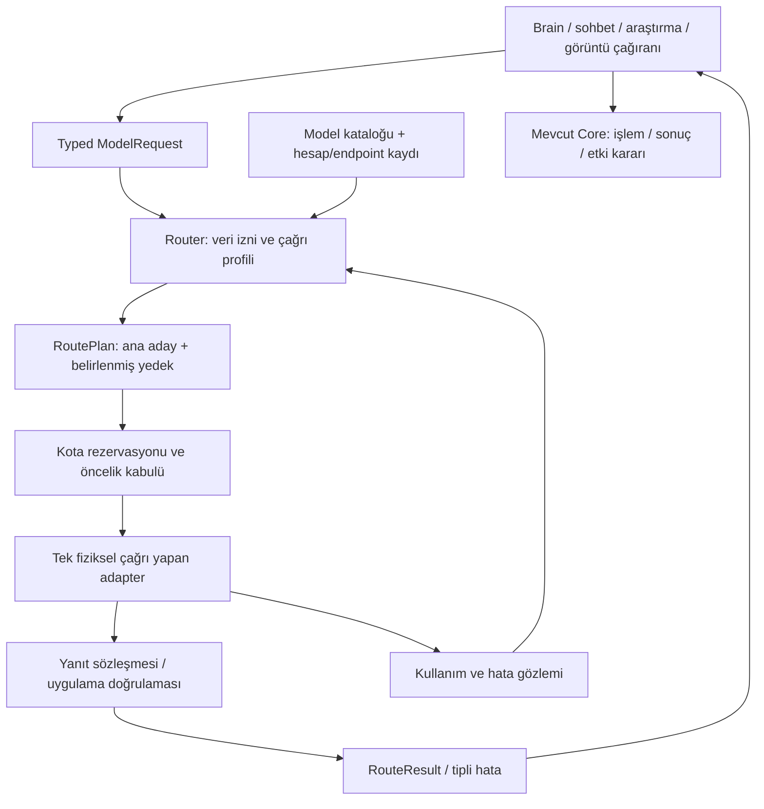

# Jarvis Router Architecture V2 — Ücretsiz ana havuz ve özel sağlayıcılar

Tarih: 10 Kasım 2026. Durum: **uygulama öncesi hedef mimari**. Kaynak tabanı `main@56e4004`; bu belge çalışan kod veya canlı kabul kanıtı değildir. Kullanıcının Gemini'yi sohbet/görüntü dahil ana aday yapma, hazır ücretli sağlayıcıları çıkarma, özel sağlayıcı alanı ve isteğe bağlı yerel model kararlarını kaydeder. Mevcut kod politikası aşağıda ayrı gösterilir; belge onu kendiliğinden değiştirmez.

Kaynak tabanlı uygulama ve eski yolların emeklilik defteri: [Uygulama ve emeklilik haritası](JARVIS_ROUTER_V2_IMPLEMENTATION_AND_RETIREMENT_MAP.md).

## 1. Amaç ve kesin kararlar

- Router sağlayıcı ve modeli birlikte seçen tek otoritedir; Brain anlamlandırır, Core etkiyi doğrular. İkinci Brain/Scheduler/GoalState kurulmaz.
- Hazır bulut havuzu yalnız kullanım koşulları doğrulanmış ücretsiz Gemini, Groq ve Cloudflare seçeneklerini içerir. Bir sağlayıcının bütün modelleri ücretsiz veya uygun varsayılmaz.
- Gemini; konuşma, Brain anlamlandırma, araştırma ve görüntü için ana adaydır. Model kimliği çağrı profili ve gerçek hesap uygunluğuyla seçilir, henüz sabitlenmemiştir.
- Groq metin için etkin alternatif; Cloudflare uygun metin işleri için ek yedektir. Ölçülmemiş kalite eşdeğerliği vaat edilmez.
- Yerel sunucu/model varsa ve işe yeterliyse kullanılabilir; Ollama zorunlu değildir. Mevcut LM Studio/llama.cpp yerel backend desteği korunur.
- OpenAI/Claude hazır sağlayıcı seçeneği olmaktan çıkarılır. Bu ve diğer servisler özel sağlayıcı alanından açıkça eklenir. Ücretsiz kota bitince ücretliye otomatik geçilmez.
- Nemotron ayrı deneysel model adayıdır; NVIDIA NIM prototip erişimi sürekli ücretsiz üretim hizmeti sayılmaz. OpenRouter hazır entegrasyonu eklenmez.
- Eski seçim/fallback yolları yeni sahip gerçek kullanıcı akışına bağlandığı pakette emekli edilir. Süresiz çift router bırakılmaz.

## 2. Kaynakta mevcut durum ve değişecek karar

`smart_router.py` ModelRequest/ModelSpec/RoutePlan/RouteResult, iki deneme, validator ve cancellation/deadline denetimi içerir. Seçilen model `llm._send_provider` üzerinden tek adapter denemesine gider; yeni Gemini yolunda SDK retry kapalıdır. `router_quota.py` atomik rezervasyon temeli sunar; `POLICIES` 16 Kasım 2026'da resmî Groq Free plan taban RPM/RPD'siyle (30/1000, üç yönlendirilen metin modeli, 23 Kasım 19:00 UTC'ye kadar) dolduruldu; resmî sayısı yayımlanmayan diğer sağlayıcılarda politikasız yol geçerlidir.

Mevcut `provider_privacy.py` Gemini'yi yalnız PUBLIC_RESEARCH için kabul eder; PRIVATE_GENERAL sırası Groq→Cloudflare→Ollama'dır. `brain_model_understanding.py` Ollama'yı ayrıca dışlar. İstenen hedef bu ikisinden farklıdır. Eski kaynak/test/gate'ler açık bir politika göçüyle taşınır; yanlış biçimde Gemini için “veriyi eğitimde kullanmaz” kaydı yazılmaz.

Model yetenek kataloğu iki Groq kimliğinin context/output sınırlarını içerir; native schema/tool yeteneği ilan etmez. Token budget üretim çağıranlarına, gerçek usage RouteResult'a, request kimliği eşzamanlı rota izlerine henüz tam bağlanmamıştır. Yerel/direct ve görüntü uyumluluk yollarının emekliliği gerekir.

## 3. Bileşenler ve veri akışı

Yeni servis veya harici broker gerekmiyor. Mevcut `smart_router`, `llm`, `requests_state`, `failure_policy`, `usage_meter`, model tercihleri ve quota store geliştirilir. Model kataloğu ile hesap/bağlantı bilgisi ayrı tutulur; birden fazla bağımsız kullanıcı ayarı otoritesi kurulmaz.

## 4. Çağrı profilleri ve gerçek yedek

Profil çağıran tarafından kapalı enum olarak verilir; prompt kelimeleriyle veya ayrı LLM çağrısıyla tahmin edilmez. Model sırası izin, hesap, yetenek, context, kota ve sağlıktan sonra oluşur.

| Profil | Ana aday | En fazla bir gerçek yedek | Özel kural |
|---|---|---|---|
| `brain_understanding` | Ücretsiz uygun Gemini; app-validator ile typed proposal | Yeterliliği ölçülmüş Groq; o uygun değilse ölçülmüş yerel model seçilebilir | Şema ve kritik yanlış işlem kabulü olmadan model bu role açılmaz |
| `conversation` | Hızlı/ekonomik uygun Gemini | Groq; uygun değilse Cloudflare veya yeterli yerel model | Sesin ilk yanıt gecikmesi dikkate alınır; TTS/STT sağlayıcısı değildir |
| `public_research` | Uygun Gemini | Göreve uygun Groq; o uygun değilse Cloudflare/yerel | Public sorgu ve kanıt provenansı korunur |
| `long_worker` | Context/çıktı bütçesi uygun Gemini | Doğrulanmış Groq veya yeterli diğer model | Gereksiz büyük model/context kullanımı yok; çıktı artifact doğrulaması Core'da |
| `vision` | Gerçek görsel API desteği doğrulanmış ücretsiz Gemini | Hazır ve görsel yeteneği doğrulanmış yerel model | Ücretsiz uygun bulut yedeği ayrıca doğrulanmadıkça Groq/Cloudflare'a görüntü gönderilmez |
| `local_only` | Seçilmiş kurulu ve yeterli yerel model | Yalnız açıkça yapılandırılmış başka uygun yerel model | Buluta geçiş yok; yoksa eksik model/bağlantı durumu |
| `custom_explicit` | Kullanıcının bu çağrı için seçtiği özel bağlantı/model | Varsayılan yok | Ücretli bağlantı ücretsiz havuzun yedeği değildir |

Bu tablo model adlarını veya ölçülmemiş Türkçe kaliteyi sabitlemez. Özellikle tek context boyutu, JSON verebilme veya büyük parametre sayısı Brain yeterliliğinin kanıtı değildir.

Plan hazırlanırken ana ve yedek açıkça seçilir. Yerel yedek seçilmişse üçüncü/dördüncü sırada kalıp bütçenin bitmesi gizlenmez. Uygunluk nedeniyle ağ çağrısından önce atlanan aday fiziksel deneme tüketmez; kalan bütçeye uygun seçim yeniden değerlendirilebilir. Başlamış iki denemeden sonra üçüncü yoktur.

## 5. Veri izni ve Gemini politika göçü

Veri kaynağı sınıflandırması kaldırılmaz. Gönderim izni ayrı bir politikadır: public, kişisel konuşma, seçilmiş dosya/görsel, kimlik bilgileri ve yerel kısıtlar aynı şey değildir. Model/provider veri kullanım bilgisi, hesap planı ve kullanıcının izin tercihi birbirinden ayrı kayıtlardır.

Kullanıcının bu mimari kararı, Gemini'nin normal sohbet ve seçilen görsellerde kullanılabilmesini hedefler. Her tur yeniden popup açılmaz. Kullanıcı ayarlarında kapsam görünür ve geri alınabilir olur. Çok kullanıcılı Jarvis'te bu sohbetin onayı başka kullanıcının onayı yerine geçmez; diğer owner mevcut bağlantı kurulumunda kendi kapsamını seçer.

Ücretsiz Gemini'nin veri kullanım koşulları doğru gösterilir; gerçeğe aykırı no-training/privacy kanıtı üretilmez. Mevcut PUBLIC_RESEARCH/PRIVATE_GENERAL kapısını sahte public etiketiyle delmek yerine account-aware gönderim izni katmanı geliştirilir. `privacy_sources` provenansı korunur; özel veri public diye yeniden etiketlenmez.

Yalnız gerekli sohbet bağlamı ve kullanıcının o iş için seçtiği içerik paketlenir. Tüm disk, tüm geçmiş veya erişilebilir bütün ekler otomatik gönderilmez. Anahtar/parola/system credential'ları prompta konulmaz. Yerel/gizli modun daha dar mevcut egress hükümleri bu tercihyle gevşetilmez. İzinli bulut yolu yoksa yazılı ve makine-okunur neden üretilir; içerik başka owner hesabına kaçırılmaz.

## 6. Sözleşmeler

Mevcut dataclass'lar kontrollü evrilir; aşağıdakiler hedef alanlardır, mevcut API iddiası değildir.

- **ModelRequest:** owner/session/request/turn kimliği, varsa goal/task/plan_version korelasyonu; çağrı profili, veri kapsamı/izin referansı, gereken özellikler, context/output bütçesi, native özellik ihtiyacı, uygulama yanıt sözleşmesi/validator kimliği, ortak deadline, presentation/goal iptal bağı, ücretsiz/explicit-custom seçimi ve en çok iki deneme. Canonical kararlar dış çağıran tarafından sahte alanlarla verilemez.
- **ModelSpec:** exact provider/model/protokol, doğrulanmış context/output/vision/schema/tool/streaming yetenekleri, free/trial/paid/unknown sınıfı ve kaynak/geçerlilik. Anahtar veya gerçek hesap bakiyesi taşımaz.
- **Connection/Account:** owner'a ait secret referansı, endpoint, protokol, aktif modeller, kapsam/ücret izni, kota grubu ve bağlantı sürümü. Mevcut kullanıcı tercihleri tek kayıt otoritesine göçer.
- **RoutePlan:** plan_id, policy/model/connection sürümleri, adaylar, seçilmiş ana/yedek ve ret nedenleri, kalan deneme/süre/maliyet bütçesi. Plan çıktıktan sonra hesap/izin/iptal değişikliği gönderim öncesi tekrar kontrol edilir.
- **ProviderAdapter:** kararlaştırılan exact modeli ve paketlenmiş girdiyi bir kez gönderir; model veya sağlayıcı seçmez. SDK retry/automatic continuation denetlenir. Token/limit verisi ve tipli hatayı döndürür.
- **RouteResult:** gerçek provider/model, request/attempt kimliği, geçerli son metin/structured çıktı, ayrı input/output/reasoning/cache kullanımı varsa o değerler, bilinmeyen alanlar null, süre/ilk token, deneme/ret izleri, finish/truncation nedeni ve yanıt doğrulama sonucu. Karakter sayısı token diye sunulmaz.

## 7. Tek deneme ve doğrulama otoritesi

Varsayılan her ModelRequest için toplam en fazla iki fiziksel üretim çağrısıdır. Şema onarımı, aynı modeli yeniden deneme ve sağlayıcıya geçiş aynı bütçeyi tüketir. Adapter/SDK kendi retry veya gizli fallback yapamaz. Ağ durumu belirsiz hatada sağlayıcının üretim yapıp yapmadığı bilinmeyebilir; bu da deneme sayılır, ücretsiz sanılmaz.

Bu sınır bütün uzun hedefin toplam iki LLM çağrısı olduğu anlamına gelmez. Üst tur/hedef için ayrıca toplam zaman/çağrı/token bütçesi mevcut runtime tarafından sınırlandırılır. Bir alt çağrı kendi bütçesini artırıp üst sınırı aşamaz.

Uygulama validator'ü tüm adaylarda aynı zorunlu sözleşmeyi uygular. Native JSON schema/tool calling ancak model VE adapter bunu gerçekten destekliyorsa kullanılır. Sadece response_schema alanı/prompt talimatı native destek değildir. Truncated çıktı tam/geçerli sonuç sayılmaz. Modelin tool önerisi mevcut Core doğrulamasından geçmeden hiçbir etki başlatmaz.

## 8. Kota, ücret ve kullanım

Ücretsiz uygunluk, model limiti ve gerçek kalan kota ayrı kavramlardır. Süresi dolan doğrulama için anlaşılır neden ve tek bağlantı bakım akışı sunulur; her testte yeni script veya hesap onayı istenmez. Resmî kaynak ve gerçek hesap bilgisi olmadan RPM/TPM rakamı uydurulmaz.

Kota anahtarı sadece owner/model değildir: sağlayıcının uyguladığı account/project/key/model-group kapsamı açıkça eşlenir. Aynı projeyi kullanan modeller ortak limiti aşamaz. Owner izolasyonu korunur; hesap kimliği anahtarın kendisi değildir. Mevcut SQLite rezervasyon aynı kayıtta quota-scope'a genişletilir; ikinci kota sayacı kurulmaz.

Gönderimden önce atomik request/token rezervasyonu yapılır. TPM/TPD kapısı için paketlenmiş input + maksimum output + varsa reasoning/görsel maliyeti doğrulanmış üst sınır gerekir. Güvenilir tokenizer/provider sözleşmesi yokken dört karakter=bir token tahmini hard gate olarak kullanılmaz. Tahmini, ayrılmış ve gerçek kullanım UI'da ayrılır; bilinmeyen null kalır.

Henüz doğrulanmış token politikası olmayan ücretsiz bağlantı; doğrulanmış ücretsiz hesap/model koşulu, uygulama istek/eşzamanlılık sınırı ve gözlenen 429/limitlerle sınırlı çalışabilir. Bu gerçek token bakiyesi veya ücret hard-stop garantisi değildir. TPM politikası açılırsa üst sınır veremeyen çağrı o adayda gönderilmez. Kayıp/eski/bozuk kota verisi sınırsız bakiyeye çevrilmez.

Başlamış çağrının rezervasyonu hata/iptalde körlemesine iade edilmez. Güvenilir gerçek usage gelirse yalnız bilinen fark uzlaştırılır; kullanım bilinmiyorsa konservatif kayıt korunur. Sağlayıcı bildiriyorsa request-limit ve token-limit resetleri ayrı izlenir. Ücretli custom bağlantıda yerel harcama tavanı ve provider billing hard limit ayrı gösterilir; üçüncü parti trafiği yerel sayaç kapsamaz. Cloudflare neuron muhasebesi modelin doğrulanmış dönüşümüne bağlanmadan tokenla eşit sayılmaz.

## 9. Hata ve bekleme

| Sınıf | Davranış |
|---|---|
| Kullanıcı/response iptali, yerel deadline | Sonraki adaya geçme; geç çıktıyı at; sağlıklı sağlayıcıya ceza verme |
| 401/403/yanlış bağlantı | İlgili bağlantıyı açıklanabilir biçimde bloke et; ücretli veya başka kullanıcı hesabına geçme |
| 429 | Bilinen model/proje kapsamı ve Retry-After/reset'e göre bekleme; diğer uygun aday aynı bütçede denenebilir |
| Taşıma timeout/5xx | Sınırlı sağlık beklemesi; kalan sürede uygun yedek |
| Şema/uygulama doğrulama hatası | Deneme tüketir; genel provider cooldown'ı yazmaz |
| Context/özellik uyuşmazlığı | Mümkünse ağ öncesi ele; hassas bağlamı sessiz kesip doğruluk iddiası üretme |
| Hiç uygun ücretsiz aday yok | Neden+bekleme/eksik ayar sonucunu runtime'a ver; modeli/providerı gizlice değiştirme |

Sağlık scope'u hataya göre connection/model/project olur; her hata bütün sağlayıcıyı gereksiz cezalandırmaz. Günlük kota/kimlik bulgusu yerel timeout altında kaybolmaz. Backoff için istek içinde uzun sleep/sonsuz polling yoktur. Arka plan hedefi mevcut runtime'da checkpoint/waiting ile kalır; uyanış uygun runtime zamanlamasıyla olur. Router kendisi yeni scheduler/cron açmaz.

## 10. Ses ve paralel işlerle kaynak paylaşımı

Model request'leri `interactive`, `background` veya `explicit_custom` iş sınıfı taşır; sınıfı güvenilir çağıran belirler. Router provider kota/eşzamanlılık kabulü yapar; CPU/GPU/worker lease sahipliği mevcut Scheduler'dadır. Kilit sırasında ağ, inference veya ses beklenmez.

Konuşma için yapılandırılmış kota/eşzamanlılık payı ayrılır; background uzun metin tüm kapasiteyi tüketemez. Interactive talepler bekleyen background taleplerinin önüne geçebilir; başlamış uzaktaki hesaplamanın fiziksel preemption'ı garanti edilmez. Kuyruklar sınırlı, sonlandırılabilir ve starvation'a karşı gözlenebilir olur. Gerçek hesap kapasitesi ölçülmeden evrensel rezervasyon sayısı uydurulmaz; küçük kapasiteli hesapta kuyruk/bekleme açıkça görünür.

Ses üretimi ve STT kendi adapter hattıdır; metin router'ı mikrofon/TTS motoru seçmez. “Sus” yalnız sunum cevabına ait request token'ını bırakabilir; bağımsız araştırma çağrısını iptal etmez. Ortak response/goal token sahipliği Voice V2 ve Brain entegrasyonunda birlikte doğrulanır.

## 11. Streaming ve yanıt yaşam döngüsü

Adapter yeteneğine göre token/metin delta, ilk token ve terminal sonuç ayrılır. Normal sohbetin güncel response'ına ait parçalar UI/ses koordinatörüne iletilebilir. Structured proposal, onay veya tool/effect kararı tam yanıt doğrulanmadan uygulanmaz. Kısmi metin geçerli Core önerisi değildir.

Her parça request_id/response generation taşır; geç sonuç yeni konuşmaya yazılamaz. İptal bağlantıyı/stream'i adapter desteklediği ölçüde kapatır. Kooperatif cancellation ile uzaktaki üretimin anında durması aynı şey değildir. Streaming yoksa UI gerçek model beklemesini gösterir; sessiz donma veya uydurma ilerleme yoktur.

## 12. Özel sağlayıcı alanı

Kullanıcı ayarlardan ad, API temel adresi, protokol, secret bağlantısı, model kimlikleri ve rol ekleyebilir; kod yazması gerekmez. Protokol adapter'ı developer tarafından incelenir. İlk protokoller OpenAI-compatible Chat Completions, mevcut OpenAI hesaplarının göçü için ayrı Responses ve Anthropic Messages adapter'larıdır; farklı protokol ayrıca adapter gerektirir. OpenAI-compatible adı OpenRouter veya tüm özelliklerin uyumluluğu demek değildir.

OpenAI/Claude hazır sağlayıcı kartı, otomatik seçim enum'u ve varsayılan ücretli havuz kaldırılır. İhtiyaç olan protokol taşıyıcısı, özel bağlantı motoru olarak yaşayabilir; eski sabit vendor seçicisi olarak değil. Eski kullanıcı anahtar/ayarları silinmez veya ücretli deneme başlatılmaz: mevcut bağlantı `custom`, disabled ve açık ücretli etkinleştirme bekleyen kayıt olarak göçebilir. Secret tekrar sohbete istenmez.

Özel bağlantının free/trial/paid/unknown sınıfı görünür olur. Trial sürekli ücretsiz havuza girmez. Paid/unknown ücretsiz çağrının otomatik yedeği olamaz. Ücretli custom kullanım kullanıcı tarafından bağlantı/rol bazında açıkça etkinleştirilir; ilgili çağrı bu explicit bağlantıya bağlı kalır. Ücretsiz olarak tanımlanan custom aday ancak gerekli yetenek/hesap/veri kontrollerinden ve açık havuza dahil etme seçiminden sonra otomatik profile girebilir.

Endpoint her bağlantının kendi secret scope'una bağlıdır; sağlayıcı A'nın anahtarı B'ye veya redirect'e gönderilmez. Uzakta TLS doğrulaması korunur. Yerel endpoint desteklenir; kullanıcı tanımlı URL keyfi dosya/protokol veya credential-forwarding kapısı açmaz. Bağlantı testi kullanıcı isterse küçük ve tek çağrıdır; ücretsiz olduğu/üretime hazır olduğu anlamına gelmez. Kaydetme veya ekranı açma arka planda sürekli ücretli test yapmaz.

## 13. Nemotron/NVIDIA deney alanı

Nemotron model ailesidir, sağlayıcı protokolü değildir. Bir modelin NVIDIA, başka servis veya yerel runtime'da sunulması farklı hesap/koşul değerlendirmesi gerektirir. NVIDIA NIM'in prototip endpoint erişimi üretim ücretsizliği kanıtı sayılmaz. Model ağırlığı lisansı NIM hizmet lisansıyla karıştırılmaz.

Deney profili sentetik/public örnek ve sınırlı fiziksel çağrı bütçesiyle çalışır; normal kullanıcı işi otomatik oraya düşmez. Mevcut NVIDIA dışlaması özel bağlantıda isim değiştirerek atlatılmaz; yeni deney kapsamı açık politika ve kaynak doğrulamasıyla tanımlanır. Güncel endpoint, veri koşulları, kota ve gerçek Türkçe görev sonucu uygun bulunursa ileride rol verilir. Model/endpoint adı burada sabitlenmedi.

## 14. Gözlenebilirlik ve kullanıcı arayüzü

Rota izi owner+request+attempt kimliğinde tutulur; `_LAST[owner]` paralel işlerin tek otoritesi olmaktan çıkar. UI'da ana/yedek rolü, gerçek model, seçilme/atlanma nedeni, hata sınıfı, bilinen bekleme, tahmini/rezervasyon/gerçek token ayrımı ve policy sürümü görülür. Prompt/cevap/anahtar tanıya konulmaz.

Hazır ücretsiz sağlayıcılar ve özel bağlantılar ayrı sunulur. Kullanıcı modelin kurulmuş/erişilebilir/ücretsiz-doğrulanmış/özellik-uygun olmasını birbirinden ayırt edebilir. Gemini veri kapsamı açık, tek kurulum tercihi olarak görünür. Native özellik iddiası yalnız kullanıcı checkbox'ıyla gerçek destek sayılmaz. Sağlayıcının bilinmeyen kalan kotası sonsuz veya sıfır diye gösterilmez. UI açılması fazladan model çağrısı yapmaz.

## 15. Emeklilik ve kod sahipliği

| Mevcut parça | Hedef ve kaldırılacak kalıntı |
|---|---|
| `smart_router.run` eski cephe | Çağıranları tam ModelRequest'a taşı; kimlik/bütçe/validator taşımayan wrapper'ın son caller'ı kalmayınca kaldır |
| `llm._with_models(model=None)` | Model dolaşımını RoutePlan'a taşı; adapter yalnız seçilen exact modeli çağırsın |
| `_ollama_task`, `ollama_model_for`, `smart_router.task_type` | Prompt regexiyle yerel model seçimi ve ayrı fallback kaldırılır; açık local profil/tercih korunur |
| Explicit Ollama validator retry döngüsü | Aynı deneme muhasebesine taşı; local-only isteğe bulut fallback ekleme |
| `_PAID`, sabit OpenAI/Anthropic seçimi, eski UI kartları | Custom connection/protokol adapter'ına göç; eski secret/tercih kaybolmasın, kullanım kendiliğinden başlamasın |
| Gemini public-only gate/testleri | Kaynak provenansı korunarak owner/account-aware izin politikasına göç; gerçek provider koşulları yanlış yazılmasın |
| Brain'in koşulsuz Ollama dışlaması | Profilde ölçülmüş yeterlilik ve kaynak/kurulu model uygunluğu; yetersiz yerel model körlemesine açılmasın |
| Görüntü direct/legacy yolu | Aynı typed vision request, model ve adapter sözleşmesi; görüntü olmayan yedeğe düşme yok |
| `_LAST[owner]`, dağınık kullanım/health kayıtları | Request trace + scoped health + RouteResult usage; mevcut usage meter tek ölçüm cephesi olarak geliştirilsin |
| Eski rehber/gap raporu ve testleri | Eski OpenRouter/sıralama/genel cooldown anlatımı tarihî olarak işaretlensin; kaldırılan iç fonksiyon testleri davranış testine göçsün |

`advisory_router.py` sağlayıcı router'ı değil cevap biçimleyicidir; sırf adı yüzünden kaldırılmaz. Embedding, STT, image generation, bağlantı testleri ve anahtar doğrulaması ayrı operasyonlardır: text-generation sınırını körlemesine uygulama; kendi izin/deneme/kullanım sözleşmeleri envanterlenir.

Ses dalı voice_core/runtime/offline ve ses adapter'larını sahiplenir. Router dalı smart_router/llm/provider/usage/kota/custom bağlantıları sahiplenir. Brain çağrı noktası ve shared web/config dosyalarında tek entegrasyon sahibi belirlenir; iki dal aynı kodu eşzamanlı yeniden düzenlemez. Güncel açık Brain PR'ları devralmadan önce yeniden kontrol edilir.

## 16. Kabul ve ölçüm

**Ağsız zorunlu regresyonlar:** her profil için aday/ret planı; Gemini konuşma/görüntü izin kapsamı ve local/gizli tercihi; yanlış owner; vision olmayan modele görüntü gönderilmemesi; iki fiziksel çağrı sınırı (repair dahil); SDK retry; paid'e sıfır otomatik geçiş; token/context paketleme; aynı proje ortak kota yarışı; yanlış/eksik limit; response iptali ve geç delta; farklı request trace'lerinin çakışmaması; custom secret isolation; eski sağlayıcı/model enum'u ve caller emekliliği; konfigürasyon göçü.

**Canlı rol seçimi:** exact model/hesap/policy sürümüyle küçük aynı-korpus karşılaştırması. Türkçe anlam, kinaye/olumsuzlama, hedef seçimi, şema geçerliliği, yanlış işlem önerisi, gerçek görüntü doğruluğu, input/output/reasoning token, first-token ve toplam p50/p95 süre ayrı ölçülür. Tek toplam puanla gecikme/kalite kusuru saklanmaz. Canlı seçim çağrı bütçesi baştan sınırlandırılır; her küçük commit'te tekrar koşulmaz.

Brain için mevcut ≥%95 doğruluk ve sıfır kritik yanlış işlem/etki kapıları korunur; gerçek kullanıcı/Windows akışı ayrıca gerekir. Sentez sesi veya sentetik corpus sonucu bütün ürünün canlı kabulü değildir. Kota hesabı, model sürümü ve ağ koşulu ölçümde yazılır. Bu belge mevcut resmi model limitlerini yeniden doğruladığını iddia etmez.

## 17. Uygulama ve kapanış sırası

1. **Typed profil + Gemini veri kapsamı + metin/görüntü üretim dikişi:** mevcut çağıranları bağla, model/owner/request kimliğini taşı, eski public-only ve vision-only-local kararlarını kontrollü göçür. Bu dilimde eski direct seçim/repair yolları aynı deneme otoritesine alınır. Ana/yedek planı UI'da açıklanır.
2. **Gerçek kullanım/kota + paralel istek/iptal:** paketleme üst sınırları, proje/model-group muhasebesi, scoped health ve request trace; interactive/background kabulünü mevcut runtime ile bağla. Ölçümsüz hesap hard-stop'u iddia etme.
3. **Özel sağlayıcı alanı ve ücretli built-in emekliliği:** protokol adapter'ları, ayar/UI, secret göçü, explicit paid davranışı, doğrulanmış custom free dahil etme ve eski kart/enum/paket artıklarını birlikte tamamla.
4. **Sınırlı canlı rol seçimi ve uçtan uca kabul:** uygun ücretsiz model kimliklerini ölçümle sabitle, gerekli exact-head CI/PC kabulünü al, kalan stale doküman/testleri kapat. Nemotron deneyi bundan ayrı isteğe bağlıdır.

Bu sıra zorunlu dört PR demek değildir. Bağımsız rollout sınırı yoksa aynı kullanıcı yeteneğini adapter/UI/test diye mikro-PR'lara bölme. Her teslim sözleşme + eski kod göçü + gerçek kullanıcı bağlantısı + emeklilik + uygun kanıt içerir. Başarılı kontrol yeni neden olmadan tekrarlanmaz. Kodun veya bu belgenin merge edilmesi Router/Brain ürün kapanışı sayılmaz.

## 18. Bilinçli açık kalan ölçüm kararları

Exact Gemini/Groq/yerel model kimlikleri, gerçek hesap/proje limitleri, Cloudflare neuron dönüşümleri, yeterli yerel donanım profili ve custom endpointlerin yetenekleri ölçümle belirlenecek. Bunlar yeni bir router mimarisi veya kullanıcıdan yeniden genel izin istemeyi gerektirmez. Yeni veri kullanım kapsamı/ücretli servis ise kendi açık bağlantı tercihini gerektirir. Uygulama kodu bu doküman turunda değiştirilmedi.
